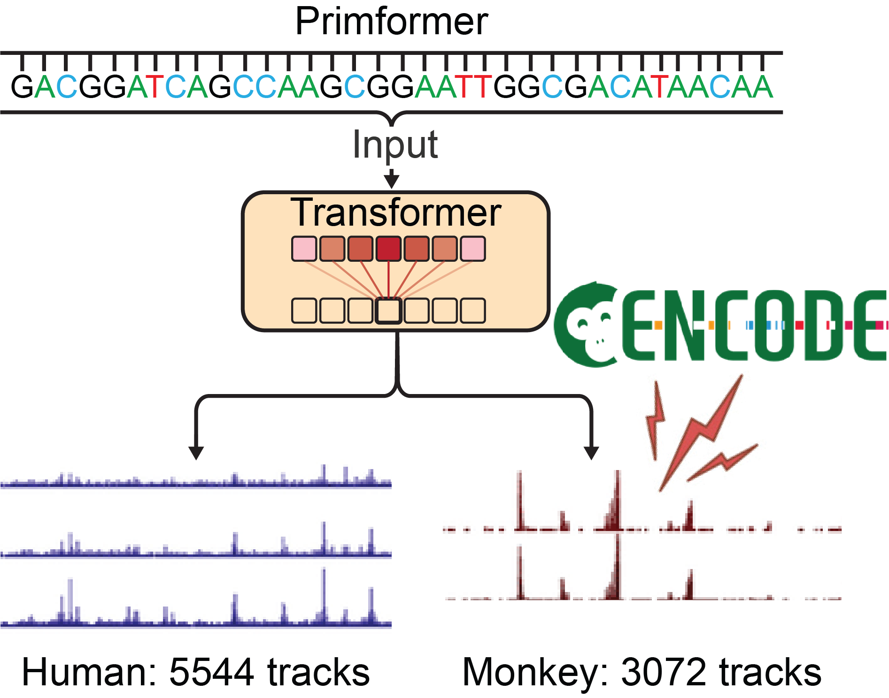

# Primformer

Primformer is a Monkey ENCODE-enhanced primate foundation model for sequence
activity prediction. The model implementation is consolidated in `src/model.py`,
and training, validation, and evaluation are controlled through `Primformer.py`.

## Model Architecture



### Code Attribution

The model architecture and implementation in [`src/model.py`](src/model.py) are
adapted from the official [Enformer code released by DeepMind](https://github.com/google-deepmind/deepmind-research/tree/master/enformer),
specifically [`enformer.py`](https://github.com/google-deepmind/deepmind-research/blob/master/enformer/enformer.py)
and [`attention_module.py`](https://github.com/google-deepmind/deepmind-research/blob/master/enformer/attention_module.py).
These upstream components provide the convolutional and Transformer backbone
and relative-position attention. In Primformer, they are consolidated into a
single module and adapted to support configurable output heads for human and
monkey sequence activity prediction.

The original code is copyright 2021 DeepMind Technologies Limited and is
licensed under the [Apache License, Version 2.0](https://www.apache.org/licenses/LICENSE-2.0).
The original copyright and license notice are retained in `src/model.py`.
Please also credit the original Enformer work described by Avsec et al.,
*Effective gene expression prediction from sequence by integrating long-range
interactions*, when using this implementation in research.

## Repository Layout

- `src/model.py`: Primformer model definition, including the Enformer-style trunk
  and relative-position attention modules.
- `Primformer.py`: unified command-line entry point for training, validation-based
  model selection, and final test evaluation.
- `src/utils.py`: TFRecord loading, metadata parsing, and evaluation metrics.
- `src/HumanData.txt` and `src/Human_wigs_class.txt`: metadata used by the human
  evaluation routine.
- `Model.png`: model architecture diagram.

## Requirements

Install the Python dependencies used by the training and evaluation scripts:

```bash
pip install tensorflow dm-sonnet numpy pandas tqdm
```

Use the TensorFlow build appropriate for your GPU/CPU environment.

## Data Layout

By default, `src/utils.py` reads datasets from:

```text
/home/users/zyfeng/DataSet/Input/<organism>/
```

Each organism directory is expected to contain:

```text
statistics.json
tfrecords/train-*.tfr
tfrecords/valid-*.tfr
tfrecords/test-*.tfr
```

The default training configuration uses:

- Human training dataset: `Human`
- Monkey training dataset: `Monkey`
- Human validation/test dataset: `Human`

Edit `organism_path()` in `src/utils.py` if your TFRecord datasets are stored in a
different root directory.

## Training

Run training with the unified entry point:

```bash
python Primformer.py --mode train \
  --checkpoint-dir /home/users/zyfeng/DataSet/SavedModel/FullAdult/ \
  --checkpoint-name MeHSA \
  --total-steps 150000 \
  --batch-size 32 \
  --learning-rate 0.0001
```

The training script uses `tf.distribute.MirroredStrategy()` and trains the human
and monkey heads in each step. It restores the latest checkpoint from
`--checkpoint-dir` when available, otherwise it starts a new model.

Useful training options:

```bash
python Primformer.py --mode train --help
```

Common options include:

- `--total-steps`: total optimization steps, default `150000`.
- `--batch-size`: global batch size, default `32`.
- `--save-every`: checkpoint interval, default `1000`.
- `--learning-rate-decay-steps`: decay interval, default `10000`.
- `--learning-rate-decay`: decay factor, default `0.95`.
- `--checkpoint-dir`: checkpoint output/restore directory.

## Validation and Model Selection

After training, compare saved checkpoints using only `tfrecords/valid-*.tfr`:

```bash
python Primformer.py --mode validation \
  --checkpoint-dir /home/users/zyfeng/DataSet/SavedModel/FullAdult/ \
  --checkpoint-name MeHSA \
  --val-start 1000 \
  --val-stop 150000 \
  --val-interval 1000 \
  --val-output validation.tsv
```

The final model is the step with the highest `Val_All`: the mean per-track
Pearson correlation coefficient across all human output tracks, computed on the
complete validation split. The earliest step wins a tie. Missing checkpoints
are skipped with a message; non-finite `Val_All` scores cannot win. Validation
fails if no eligible checkpoint is found. Test data is not read during selection.

`validation.tsv` contains `Steps`, `Val_All`, `Val_CAGE`, `Val_RNA`, `Val_ATAC`,
`Val_ChIPH`, and `Val_ChIPT`. Each run overwrites this table. By default,
validation scans steps `1000` through `150000` (inclusive), every `1000` steps.

After a successful scan, the selected checkpoint is copied into
`<checkpoint-dir>/best_model/`, alongside `selection.json`, which records the
selected step, validation metrics, and dataset. This copy remains available even
if training later removes the original checkpoint through its retention policy.
Keep the `best_model` directory together when moving the final model.

## Evaluation on the Test Set

Run evaluation after validation has selected the final model:

```bash
python Primformer.py --mode eval \
  --checkpoint-dir /home/users/zyfeng/DataSet/SavedModel/FullAdult/ \
  --eval-output evaluation.tsv
```

Evaluation reads `best_model/selection.json`, restores only the selected
checkpoint, and runs once over the complete `tfrecords/test-*.tfr` split.
No start, stop, interval, or checkpoint-name arguments are needed for evaluation.
Use the same
`--human-dataset` as validation (default `Human`). Run training and validation
sequentially so candidate checkpoints remain stable during selection.

`evaluation.tsv` contains one result row with `Steps`, `Test_All`, `Test_CAGE`,
`Test_RNA`, `Test_ATAC`, `Test_ChIPH`, and `Test_ChIPT`. Each run overwrites this
table. These final predictive-performance metrics are Pearson correlation
coefficients, not classification accuracy percentages. Undefined group
correlations may be `nan`; a non-finite `Test_All` causes evaluation to fail.

The `--val-start`, `--val-stop`, and `--val-interval` options apply only to
validation. Validation and final evaluation always use their complete splits.

Show all command-line options:

```bash
python Primformer.py --help
```
